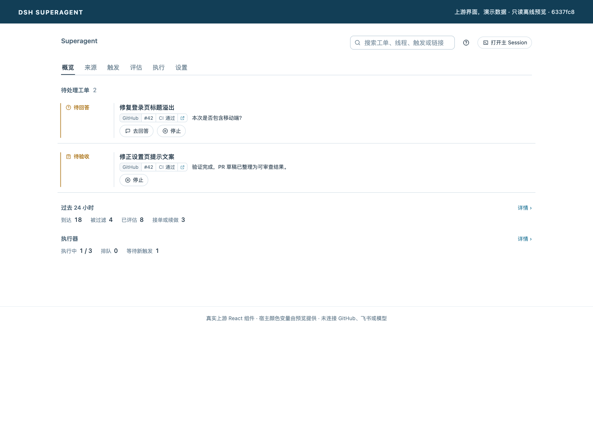
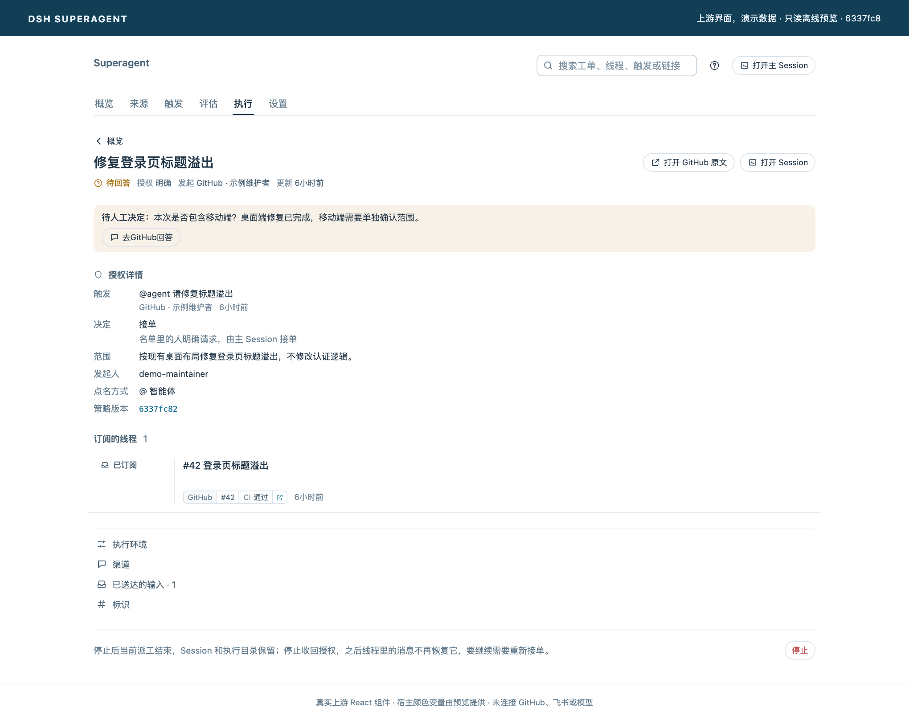
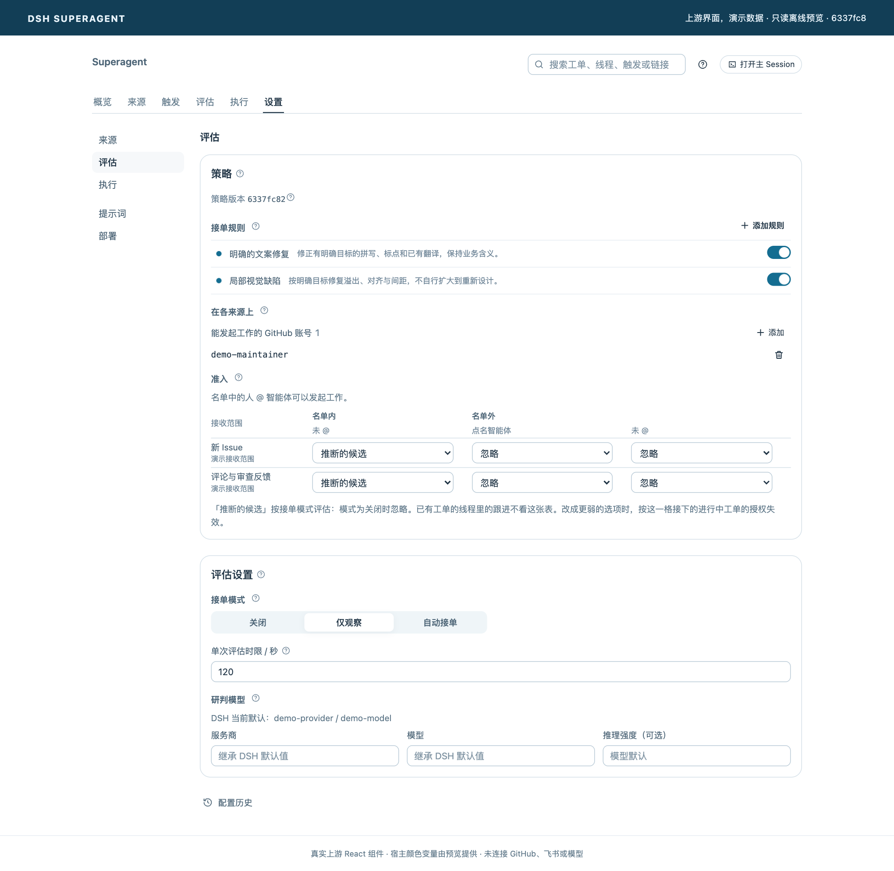
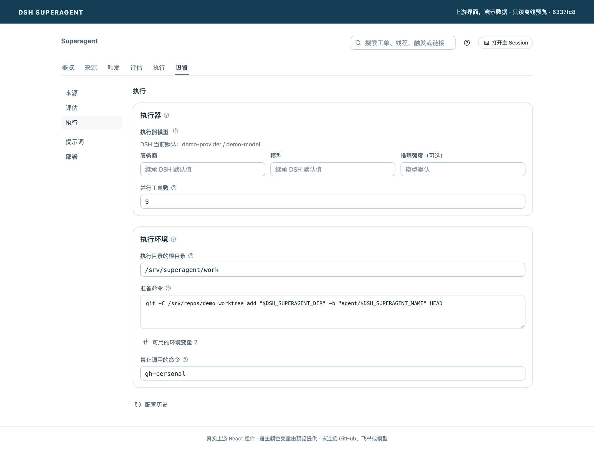

# DSH Superagent 剖析

**读懂持续在线 Agent 的运行机制，把可借鉴的设计用到自己的项目。**

本项目以 DeepSeek 的 [dsh-superagent-prototype](https://github.com/deepseek-ai/dsh-superagent-prototype) 为工程样本，解释外部事件如何变成被授权的任务、如何并行执行、如何在反馈和重启后继续，以及何时需要人介入。

这是独立的中文分析项目。上游是研究原型，官方明确说明它与内部版本及架构文章并不完全相同。本文区分 **Super-agent 的架构思路**与**公开原型已实现的行为**，以固定源码为依据；本版不包含竞品对比。

| 分析基线 | 内容 |
| --- | --- |
| 上游提交 | [`6337fc823ce20251c8de8085948165c81aaa701e`](https://github.com/deepseek-ai/dsh-superagent-prototype/commit/6337fc823ce20251c8de8085948165c81aaa701e) |
| 核对日期 | 2026-11-01，Asia/Shanghai |
| 图像与验证 | 5 张机制图、4 张真实组件的演示数据截图；[验证范围](docs/reference/verification.md) |

## 1 项目概览：它是什么

Super-agent 探索的是让系统接过会话管理、信息分发与任务跟进，使人专注于目标、决策和验收。公开原型把这套思路应用于**单个 GitHub 仓库的研发协作**：作为 DSH Bundle，接入 GitHub 和可选飞书，维护持续工单，并把可用结果回到原讨论。

模型不是永远在推理；持续的是事件入口、工作状态与任务关系。Worker 的一个回合结束，也不意味着业务工作随之消失。

→ [项目定位、概念模型与适用范围](docs/01-overview.md)

## 2 架构设计：它怎么建

Source 将平台消息转成 Trigger，Engine 组织授权和工单状态，主 Session 负责语义路由，Executor 管理每个任务的 Worker 与目录。SQLite 保存工作脉络，Effects 和 Outbox 在事务提交后执行与投递。

*固定源码的实现示意。DSH 提供会话和执行能力；本图不表示已实现分布式 Agent 控制面。*

→ [领域模型、调用路径、并发与持久化](docs/02-architecture.md) · [源码索引](docs/reference/source-map.md)

## 3 核心功能：它能做什么

- 接收授权用户的明确请求，也可按规则评估主动候选。
- 为任务分配持久工单、独立会话与目录，按并发上限执行。
- 通过讨论订阅继续处理评论、审查与 CI 反馈。
- 将待回答、待审查、受阻和失败工作交给人处理。
- 保存输入、派工与投递记录，支持明确范围内的重试和恢复。
- 在面板配置来源、策略、执行和提示词，并保留配置历史。

*所有工单和统计均为演示数据，未连接真实 GitHub、飞书或模型。*

| 工单详情 | 评估与授权 | 执行环境 |
| --- | --- | --- |
| [查看大图](assets/screenshots/ticket.png) | [查看大图](assets/screenshots/policy.png) | [查看大图](assets/screenshots/execution.png) |
|  |  |  |

→ [功能条件、反馈路径与状态边界](docs/03-capabilities.md) · [离线界面预览与复现](tools/preview/README.md)

## 4 设计取舍：哪些值得借鉴

| 设计 | 借鉴价值 |
| --- | --- |
| Ticket 与 Assignment 分开 | 业务任务可以跨执行尝试保持连续 |
| Mandate 与上下文分开 | 收到新信息不自动扩大工作授权 |
| Thread 与 Subscription | 让后续反馈找到原任务，减少人工转发 |
| Engine 与 Effects/Outbox | 状态修改有事务边界，外部动作可记录和重试 |
| 路由与执行分工 | 将协调与具体工作分开，明确消息归属 |
| 结构化 Attention | 告诉人需要回答、审核还是处理环境问题 |

这些设计的价值来自组合和边界管理。共享聊天记录、增加并发或多启动几个 Agent，并不能单独证明已经降低了人的协调成本。

→ [机制、代价和可借鉴方式](docs/04-design-lessons.md)

## 5 使用与上手：怎么开始

**只看机制与界面**：本仓库文档和图片可直接阅读；[离线预览](tools/preview/README.md)使用上游真实组件和演示数据，不需要平台凭据。

**实际部署原型**：先准备专用运行环境、Agent GitHub 账号和可用的 DSH 模型配置，从 GitHub-only、少数允许用户和小任务开始，按[上手指南](docs/05-getting-started.md)验收从事件到交付的完整路径。

注意两个直接影响使用的边界：`observe` 只阻止推断候选实际接单，显式授权请求仍可能执行；独立目录和命令包装不是 OS 沙箱。

→ [环境、安装、设置、首次工单与排障](docs/05-getting-started.md)

## 将设计用到自己的项目

[迁移指南](docs/06-adaptation-guide.md)提供三条路径：部署原型、增加 Source、在已有 Agent 中采用部分机制。每条路径都说明依赖、替换点和验证思路，不要求先重写一套 Superagent。

| 阅读目标 | 建议路径 |
| --- | --- |
| 先建立全景 | 本页 → [概览](docs/01-overview.md) → [功能](docs/03-capabilities.md) |
| 理解运行机制 | [架构](docs/02-architecture.md) → [功能](docs/03-capabilities.md) → [源码索引](docs/reference/source-map.md) |
| 借鉴到自己的项目 | [设计取舍](docs/04-design-lessons.md) → [迁移指南](docs/06-adaptation-guide.md) |
| 动手尝试原项目 | [上手](docs/05-getting-started.md) → [验证边界](docs/reference/verification.md) |

## 依据、贡献与许可

重要实现链接固定到上游提交；[资料来源](docs/reference/sources.md)和[验证记录](docs/reference/verification.md)说明事实依据与实际检查范围。欢迎带源码位置和适用版本提交勘误，流程见 [CONTRIBUTING](CONTRIBUTING.md)。

原创分析与图示采用 [MIT](LICENSE)。上游组件、文案及引用材料保留其原有署名和许可，见[第三方声明](THIRD_PARTY_NOTICES.md)。
