# 01 项目概览：从会话工具到持续协作者

[返回首页](../README.md) · [下一章：架构设计](02-architecture.md)

## 先分清架构思路和公开原型

Super-agent 讨论的是一种工作形态：人在数字环境中给出目标，系统持续接收相关事件、组织任务并保留工作脉络；人主要参与关键决策和结果验收。这里最值得研究的指标是管理这些工作的注意力成本：是否需要人反复切换窗口、重复解释背景、转发反馈和检查任务有没有卡住。

`dsh-superagent-prototype` 是这一方向的一个具体工程样本：它围绕**一个 GitHub 仓库**工作，以 DeepSeek Harness（DSH）的 Bundle 扩展形式运行，接收 GitHub 和可选的飞书消息。允许的请求可以形成工单，由独立 Agent 会话和目录执行，结果回到发起讨论的地方。[上游定位][upstream]

两者的范围不同。公开仓库明确说明：它是研究原型，公开版本经过整理，与内部版本及《Exploring Super-agent Design: Towards a More Autonomous Agent System》所述实现不完全相同，文章的部分内容属于未来方向。因此本文把源码中能定位的行为作为“当前实现”；宏观目标用来解释动机，不据此补出仓库里不存在的功能。

*概念示意：持续性属于系统组织方式，不要求模型始终进行推理；具体实现见下一章。*

## 一个具体工作场景

团队成员在 Issue 中写下 `@agent 请修复登录页标题溢出，保持现有布局`。系统辨认事件及来源，确认请求的授权依据与工作范围，创建 Ticket。Worker 在自己的目录中处理并验证修改，通过原讨论交付结果。如果产生 PR，该 PR 的评论、审查和 CI 可以继续成为这个工单的输入。

对于使用者，关键变化是：后续协作围绕原来的工作与讨论继续，无须为每条反馈新开一个独立会话，再手动搬运背景。这个效果来自持久工单、订阅、消息投递和会话管理的配合。[领域模型][domain]

它也不是“看见什么就自动改什么”：主动候选受接收范围、允许名单、规则与接单模式约束；Worker 收到的上下文不能直接扩大任务授权。

## 它由哪些东西组成

| 部分 | 在这个项目中的作用 | 阅读入口 |
| --- | --- | --- |
| DSH | 提供 Agent、Session、模型、工具、工作空间和 Web 宿主能力 | [架构边界](02-architecture.md) |
| Superagent Bundle | 接入事件，记录授权和工单，组织评估、执行、回复与恢复 | [当前实现][engine] |
| GitHub Source | 监听指定仓库中的通知、讨论和相关状态，按配置扩大接收范围 | [来源实现][github] |
| 飞书 Source | 可选的群聊、私聊与消息上下文入口 | [核心功能](03-capabilities.md) |
| 管理面板 | 展示需要人处理的工单、系统问题、执行状态与设置 | [面板说明][panel] |

## 设计目标落在哪里

上游的原则是“尽量少占用人的注意力，尽量多提供价值”。这在代码与交互中表现为：[设计哲学][philosophy]

- **工作有连续对象**：Ticket 的存在不取决于某一次模型调用是否结束。
- **反馈自动回到任务**：Thread 与 Subscription 将后续消息送给相关工单。
- **执行彼此分开**：工单有对应的 Session 和工作目录，支持受控并发。
- **需要人时说明具体问题**：用结构化 Attention 标记待回答事项，面板优先显示这些工作。
- **正常工作少打扰**：普通进度留在工单和会话，需要决策、可用结果或无法完成时再面向人沟通。

这些是设计机制，不是已经量化的生产力收益。要验证收益，应观察人工分派、上下文重复、手动唤醒和无效通知的数量，而非只数同时启动了几个 Worker。

## 适合怎样阅读和使用

适合把它作为事件驱动 Agent 系统的工程案例，研究任务建模、授权、异步协作、持久投递和面板设计；也适合在专用环境中，先以单仓库、少数允许用户的方式试用。

如果目标是多租户 SaaS、跨仓库统一调度或强隔离的执行平台，需要另外补齐相应设计。原型明确以操作系统用户权限运行；目录划分与命令包装不构成安全沙箱。[部署前提][deployment]

下一章沿一条请求追踪各层如何协作；需要直接尝试时，可跳到[使用与上手](05-getting-started.md)。

[deployment]: https://github.com/deepseek-ai/dsh-superagent-prototype/blob/6337fc823ce20251c8de8085948165c81aaa701e/docs/006-deployment.md#L13
[domain]: https://github.com/deepseek-ai/dsh-superagent-prototype/blob/6337fc823ce20251c8de8085948165c81aaa701e/docs/001-domain.md#L5
[engine]: https://github.com/deepseek-ai/dsh-superagent-prototype/blob/6337fc823ce20251c8de8085948165c81aaa701e/src/core/engine.ts#L24
[github]: https://github.com/deepseek-ai/dsh-superagent-prototype/blob/6337fc823ce20251c8de8085948165c81aaa701e/src/sources/github.ts#L25
[panel]: https://github.com/deepseek-ai/dsh-superagent-prototype/blob/6337fc823ce20251c8de8085948165c81aaa701e/docs/005-panel.md#L5
[philosophy]: https://github.com/deepseek-ai/dsh-superagent-prototype/blob/6337fc823ce20251c8de8085948165c81aaa701e/docs/000-philosophy.md#L1
[upstream]: https://github.com/deepseek-ai/dsh-superagent-prototype/blob/6337fc823ce20251c8de8085948165c81aaa701e/README.md#L3
