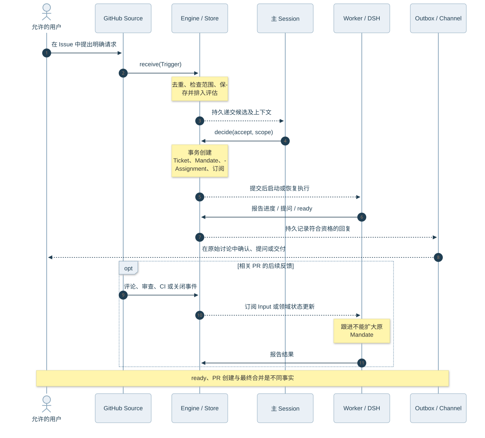
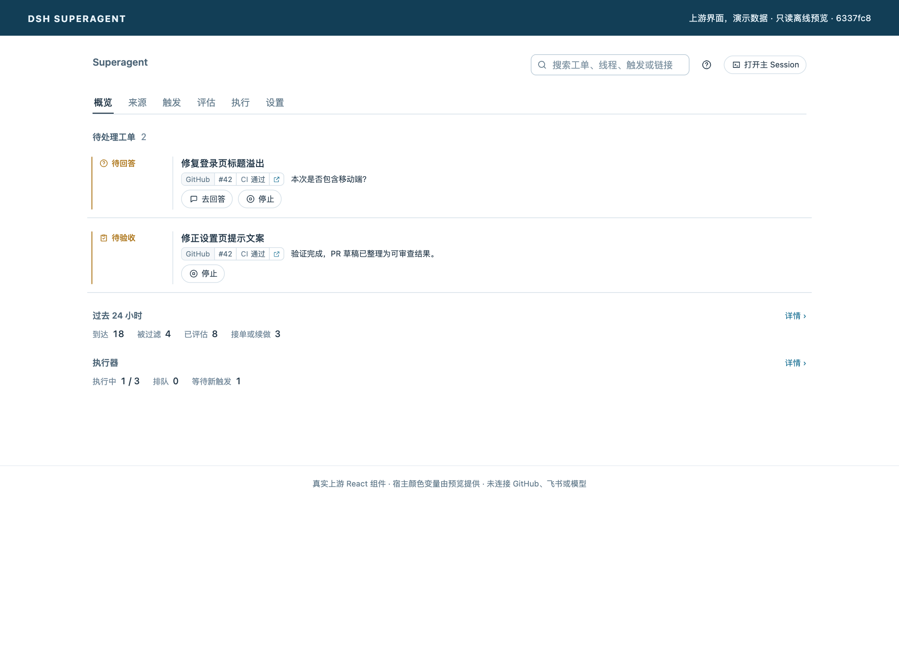

# 02 架构设计：事件如何变成持续工作

[返回首页](../README.md) · [上一章](01-overview.md) · [下一章：核心功能](03-capabilities.md)

## 先看边界，再看流程

这个项目的控制核心是确定性的领域 Engine，语义判断与真实工具执行通过接口连接到它。Runtime 负责装配、启动与停止；DSH 提供会话和模型执行。这样可以区分“系统允许发生什么”和“模型认为现在应该做什么”。[Runtime][runtime]、[Engine][engine]

*实线为调用或投递路径；主会话和 Worker 使用 DSH，SQLite 保存领域状态与待执行工作。图中没有假设分布式调度或远程执行控制面。*

| 层 | 入口文件 | 责任 |
| --- | --- | --- |
| 外部适配 | `src/sources/` | 将平台事件变成 Trigger，提供原讨论的读取和回复能力 |
| 应用装配 | `src/app/runtime.ts` | 锁定状态目录，创建 Store、Engine、评估器、执行器等，管理启停 |
| 领域规则 | `src/core/` | 接入、评估生命周期、工单、派工与回复资格，统一事务边界 |
| 语义评估 | `src/app/assessment.ts` | 将候选递交主 Session，并通过 Engine 接收决定 |
| 执行适配 | `src/executor/dsh.ts` | Worker Session、工作目录、并发槽、输入投递和后台工作 |
| 持久化与外部工作 | `store.ts`、`effects.ts`、`outbox.ts` | 保存状态，提交后执行外部操作，记录并重试投递 |
| Web 面板 | `src/client/` | 通过管理 API 查询状态与设置，提供人工动作入口 |

## 领域概念为什么这样拆

| 概念 | 含义 | 与相邻概念的区别 |
| --- | --- | --- |
| Source | 事件来源与其接收规则 | 平台 API 留在适配器，不直接进入领域逻辑 |
| Trigger | 一次不可变事件，含稳定 ID、发送者、时间和内容 | 同一事件重复到达仍是同一个 Trigger |
| Thread | 来源定义的一组连续事件，如一个 Issue 或 PR 下的讨论 | 不等于一个任务；同一讨论可涉及多个 Ticket |
| Eval / Decision | 一批事件的评估过程及留下的决定 | gate 判断授权基础，assessment 进行语义判断 |
| Mandate | 接单时确定的授权依据与工作范围 | 输入更多信息不会自动扩大它 |
| Ticket | 一项被授权的工作 | 是业务连续对象，不是模型会话的别名 |
| Assignment | 某次执行器承接工单的记录 | 重试和重启可产生新的 Assignment |
| Subscription | Ticket 与 Thread 的多对多订阅关系 | 转发上下文，不授予新权限 |
| Channel | 回复原讨论的地址与写入能力 | 读取上下文与写入结果分别建模 |

以上概念和约束见[领域模型][domain]；对照代码阅读可使用[源码索引](reference/source-map.md)。

## 请求的完整路径

1. GitHub Source 将消息转换成 Trigger。默认轮询间隔为 60 秒，平台要求更长时遵从平台；这不是要求人等在聊天窗口里的同步调用。
2. `Engine.receive` 在事务内交给 Intake。Intake 先去重，再检查 SourceScope；范围外事件也留下过滤原因，方便解释“为什么没接单”。
3. 输入会分发给订阅相关 Thread 的 Ticket。人的跟进消息若已有负责它的 Worker，就留给该 Worker 判断；其余事件进入评估队列。
4. 每个 Thread 同时最多有一个 Eval。评估使用当时的策略版本、候选批次和已有工单，决定 accept、stop、ignore 或 unavailable。
5. accept 在领域事务中创建工单、Mandate、首次 Assignment 及相关订阅，并将启动与回复等外部工作排入队列。
6. Executor 在事务之外准备目录，创建或继续 `worker-<ticketId>` 会话，执行工具并向 Engine 报告结构化状态。
7. 回复经 Outbox 持久记录，再通过 SourceRegistry 的 Channel 发送。PR 反馈可经订阅继续进入工单。

可沿[接入][intake]、[决策入口][engine]、[工单][tickets]、[评估器][assessor]和[执行器][executor]顺序验证。

## 为什么既有 Engine，又有 Effects

Engine 的公开写操作是同步的，每次领域命令把相关状态放在 SQLite 事务里修改。调用 Executor 或 Outbox 的端口时，只安排后续工作；真实网络请求、会话投递和工具运行在提交后进行。[Store][store]、[Effects][effects]

例如，工单已经写入但进程立刻退出时，持久的启动意图仍可在重启后继续执行。它解决的是“记录状态”和“执行外部动作”之间的恢复问题。它不让 GitHub 或飞书的外部写入与 SQLite 共享一个原子事务，也不提供通用的 exactly-once 保证；重复尝试仍依赖稳定标识、状态检查和具体适配器的幂等处理。

Outbox 专门保存消息回执；同一 ID 不重复入队。同一工单发往同一讨论的消息会按规则保持顺序，前面的消息反复失败后，不再无限阻挡后续消息。来源关闭时消息等待，目标不再接收或已消失时记录 dropped。[Outbox][outbox]

## 并发、非阻塞和持久性

Worker 使用并发槽限制资源，默认 `maxWorkers = 3`。人的消息或状态请求有一个额外槽位，避免新任务一直挤掉正在等待人工反馈的旧任务。目录准备也占槽，但不同启动可并发，慢 prepare 不阻挡其他工单。[并发实现][slots]

Router 与 Worker 的预设让前台 shell 命令在 5 秒后转后台，结果到达后唤醒相应执行。这让会话能在后续步骤接收新输入；它不表示操作系统线程在整个任务期间一直执行模型推理。[执行约定][execution]

重启保留会话、目录、订阅、待投递输入和持久状态。被中断的 Assignment 可由替代 Assignment 接续，并带恢复说明。后台进程本身未必存活；进程退出后的恢复能力来自记录与重放，不是保住原来的进程。[恢复说明][recovery]

## 人的界面也是架构的一部分

面板围绕“谁需要做什么”组织，先显示待回答、待审查、受阻和失败等事项。`ticketStage` 根据结构化字段按优先级计算阶段，避免从自由文本猜测“是否需要人”。[状态分类][stage]

*固定版本上游 App 的离线组件截图；所有工单和统计为演示数据，未连接 GitHub、飞书或模型。*

[assessor]: https://github.com/deepseek-ai/dsh-superagent-prototype/blob/6337fc823ce20251c8de8085948165c81aaa701e/src/app/assessment.ts#L89
[domain]: https://github.com/deepseek-ai/dsh-superagent-prototype/blob/6337fc823ce20251c8de8085948165c81aaa701e/docs/001-domain.md#L5
[effects]: https://github.com/deepseek-ai/dsh-superagent-prototype/blob/6337fc823ce20251c8de8085948165c81aaa701e/src/app/effects.ts#L46
[engine]: https://github.com/deepseek-ai/dsh-superagent-prototype/blob/6337fc823ce20251c8de8085948165c81aaa701e/src/core/engine.ts#L24
[execution]: https://github.com/deepseek-ai/dsh-superagent-prototype/blob/6337fc823ce20251c8de8085948165c81aaa701e/docs/003-execution.md#L23
[executor]: https://github.com/deepseek-ai/dsh-superagent-prototype/blob/6337fc823ce20251c8de8085948165c81aaa701e/src/executor/dsh.ts#L207
[intake]: https://github.com/deepseek-ai/dsh-superagent-prototype/blob/6337fc823ce20251c8de8085948165c81aaa701e/src/core/intake.ts#L19
[outbox]: https://github.com/deepseek-ai/dsh-superagent-prototype/blob/6337fc823ce20251c8de8085948165c81aaa701e/src/app/outbox.ts#L22
[recovery]: https://github.com/deepseek-ai/dsh-superagent-prototype/blob/6337fc823ce20251c8de8085948165c81aaa701e/docs/003-execution.md#L148
[runtime]: https://github.com/deepseek-ai/dsh-superagent-prototype/blob/6337fc823ce20251c8de8085948165c81aaa701e/src/app/runtime.ts#L59
[slots]: https://github.com/deepseek-ai/dsh-superagent-prototype/blob/6337fc823ce20251c8de8085948165c81aaa701e/src/executor/dsh.ts#L171
[stage]: https://github.com/deepseek-ai/dsh-superagent-prototype/blob/6337fc823ce20251c8de8085948165c81aaa701e/src/core/stage.ts#L9
[store]: https://github.com/deepseek-ai/dsh-superagent-prototype/blob/6337fc823ce20251c8de8085948165c81aaa701e/src/app/store.ts#L45
[tickets]: https://github.com/deepseek-ai/dsh-superagent-prototype/blob/6337fc823ce20251c8de8085948165c81aaa701e/src/core/tickets.ts#L29
