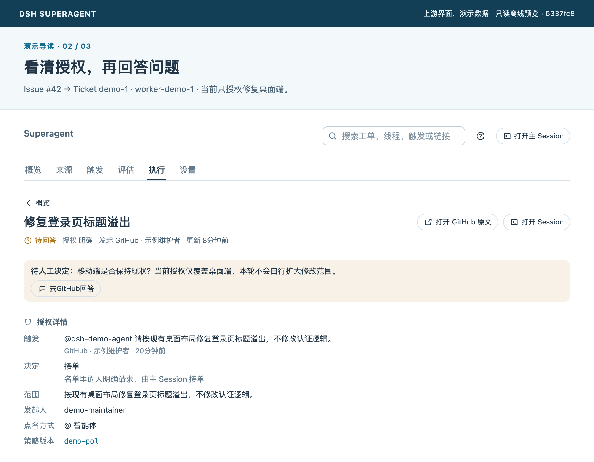
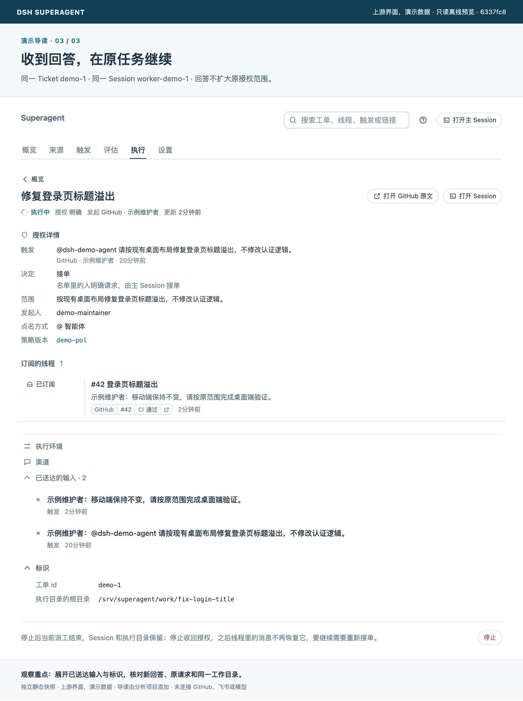

# 03 核心功能：工作怎样启动、继续和结束

[返回首页](../README.md) · [上一章](02-architecture.md) · [下一章：设计取舍](04-design-lessons.md)

## 功能地图

| 能力 | 当前原型做什么 | 必要条件和边界 |
| --- | --- | --- |
| 显式请求 | 将允许用户发给 Agent 的请求交给路由，形成授权工单 | 受 Source 接收范围、身份与授权检查约束 |
| 主动候选 | 从配置接收的事件中按规则评估是否值得开展工作 | 推断接单需要 auto 和匹配规则；默认 observe |
| 多工单执行 | 每个工单有 Worker Session 和独立目录，受并发上限控制 | 默认目录可以是空目录，checkout 由 prepare 配置 |
| 持续跟进 | 把订阅讨论中的相关消息送给工单，继续处理反馈 | 上下文不扩大 Mandate；已结束和人工停止的工单规则不同 |
| 人工介入 | 结构化问题、审查、阻塞和失败状态 | 由面板和原始讨论承接，不要求人一直看模型输出 |
| 恢复与重试 | 保留状态和待投递工作，处理部分网络故障和重启 | 不是任何失败都无限自动重试 |
| 设置与提示词 | 独立配置来源、授权、模型、执行和团队提示词，保存历史 | 提示词不能改写代码强制的门禁和工具检查 |

来源：[授权][authorization]、[执行][execution]、[提示词][prompts]与[面板][panel]。

## 事件入口：监听不等于授权执行

GitHub 来源先接收发给 Agent 账号的通知和已订阅讨论。按配置还可接收仓库中的新 Issue、PR、评论和默认分支 CI。`observeIssues`、`observePulls`、`observeComments`、`observeCi` 默认均为 false；打开这些开关只是扩大输入范围。[GitHub Source][github]

飞书为可选来源，可配置群聊接收全部消息或仅 @、私聊以及其他群的提及范围。接收规则、允许名单与后续语义评估是不同层次。

## 主动程度由哪些开关决定

| 模式 | 推断候选 | 显式请求 |
| --- | --- | --- |
| off | 不进入推断评估 | 仍可按授权处理 |
| observe | 评估后记录“本会接单”，不实际接受推断工作 | 仍可按授权处理 |
| auto | 满足规则和校验后可接受推断工作 | 仍可按授权处理 |

**observe 不是全系统只读开关。** 允许用户的显式请求仍可能实际启动修改；要暂停自动处理，应使用执行区的 Pause processing，并按部署需求控制账号与环境权限。[模式定义][modes]

语义接受也不是随意猜测。当前策略验证规则覆盖情况、实施意图、目标是否明确、是否尚需设计决定等信息。默认规则较窄，集中在明确的文案与局部视觉修复；“有主动 Agent 架构”不代表默认自动开展任意类型工作。[策略实现][policy]

[评估策略界面](05-getting-started.md#设置界面参考)放在上手章节，便于对照允许名单、规则与 observe 的配置位置。

## 同一个任务如何不断线

Thread 是讨论，Ticket 是工作。订阅把某条讨论中的后续事件持续送给相关工单，因此反馈可以无需再次 @ Agent 就回到执行器。一个 Thread 可以关联多个 Ticket，一个 Ticket 也可以跟踪多个 Thread。

人的跟进消息有归属：已有 Worker 负责时，由它决定是否在当前范围内处理；越界或属于其他工作的消息可以交回路由。Router 不会在已有 Worker 尚未释放消息时再次把它接成新工作。只因话题相似就附加到工单也不够，需有明确指向。[接入与归属][intake]、[授权说明][authorization]

由 Worker 仅为参考而订阅的讨论，提供上下文，不提供新的请求权限，也不会唤醒已结束工单。此设计避免“读到一段文字”自动变成“被允许按它做事”。

*图中为 Issue #42 对应的 Ticket demo-1：当前只授权修复桌面布局，Worker 提问确认移动端是否保持现状。演示数据没有对应的真实 Issue 或 PR。*

### 从待回答到继续执行

维护者在原讨论回答：“移动端保持不变，请按原范围完成桌面端验证。”同一 Ticket 的后续快照如下：

| 核对项 | 待回答时 | 回答后 |
| --- | --- | --- |
| 业务任务 | Ticket `demo-1` | 同一 Ticket `demo-1` |
| 执行会话与目录 | `worker-demo-1`，`fix-login-title` 目录 | 保持一致 |
| 输入 | 原请求，已送达 | 原请求＋人的回答，均已送达 |
| 授权范围 | 桌面布局，不改认证逻辑 | 保持一致；回答未授权扩展到移动端 |
| 当前阶段 | 待回答 | 执行中；问题已清除 |

本例属于开放工单的人工回答续做，沿用当前 Assignment；不会为了每条反馈创建新工单或新派工。重试等路径可能产生新的 Assignment，应与任务身份分开理解。[接入与归属][intake]、[恢复与失败处理][recovery]

上图通过原界面的折叠控件展开“已送达的输入”和“标识”。两个阶段是为讲解机制准备的独立静态快照，不是点击回答后真的驱动了 Engine；浏览器检查仅验证演示数据及界面的一致性。

## 执行和后台工作

首次 Assignment 前，如果目录不存在，执行配置中的 prepare 命令有最多十分钟准备时间。常见做法是从目标仓库 clone 创建 worktree；不设置 prepare 时 Worker 会从空目录开始。路径与环境变量由执行器和 Source 提供，方便选择 Issue、PR head 和工作名。[执行器][executor]

默认普通并发为三个 Worker。等待人回答或交付审查时会释放槽位；后台任务仍在运行时，通常保留该任务的槽位。人的后续消息有优先继续工作的机会。应按模型与机器资源调节并发，而不把并发数当成已完成的任务数。

目录、并发和 prepare 的[设置界面参考](05-getting-started.md#设置界面参考)放在上手章节。

## ready、等待、结束是不同事情

- `waiting` 表示当前回合没有要问人的问题，等待新事件；业务工单可以继续存在。
- `ready` 表示可交付或待审查。没有需要继续跟踪的 PR 等 Thread 时可以完成；有相关跟踪对象时，还要看它们的关闭条件。
- Thread 关闭时，工单是否结束由 `followsDone` 等规则确定。存在自己创建的跟踪 Thread 时，以这些 Thread 为主；否则检查所跟踪 Thread。
- 因完成、合并或普通关闭而结束的工单，可以在授权重新验证后由其所属讨论中的人的消息恢复；机器人和 CI 不会唤醒已结束工单。
- 人主动停止会撤回 Mandate，工单不再接收后续输入，新的工作需要新的接受决定。

“有 PR”“Worker 回合结束”“任务完成”“PR 已合并”不能互换。[工单规则][tickets]、[阶段分类][stage]

## 出错之后发生什么

输入投递和外部工作队列提供持久重试，退避避免短暂网络抖动立刻打扰人。执行器也识别部分临时网络和模型提供者故障。准备目录失败、受阻或持续失败不会被无限掩盖，最终需要人处理。

重试可产生新的 Assignment，并复用原 Session、目录、分支与 PR；它不是每次复制出一个全新的业务任务。来源和消息发送还有各自的健康状态与投递回执，应在面板中分别排查。[恢复与失败处理][recovery]

## 可编辑的团队行为

团队可编辑 Communication、Ticket scope、Delivery requirements，加入技能，并覆盖内置提示词。配置按版本保存；已有覆盖基于旧默认文本时，升级会提示默认内容变化。会话在后续模型请求读取最新版本，保存本身不等于重启或唤醒任务。[提示词版本][prompts]

需要强调：合并条件等团队提示词约定不能替代 GitHub 分支保护；允许名单、Mandate 和工具参数检查由代码落实。哪些适合写成规则，哪些需要硬约束，下一章继续讨论。

[authorization]: https://github.com/deepseek-ai/dsh-superagent-prototype/blob/6337fc823ce20251c8de8085948165c81aaa701e/docs/002-authorization.md#L7
[execution]: https://github.com/deepseek-ai/dsh-superagent-prototype/blob/6337fc823ce20251c8de8085948165c81aaa701e/docs/003-execution.md#L23
[executor]: https://github.com/deepseek-ai/dsh-superagent-prototype/blob/6337fc823ce20251c8de8085948165c81aaa701e/src/executor/dsh.ts#L207
[github]: https://github.com/deepseek-ai/dsh-superagent-prototype/blob/6337fc823ce20251c8de8085948165c81aaa701e/src/sources/github.ts#L25
[intake]: https://github.com/deepseek-ai/dsh-superagent-prototype/blob/6337fc823ce20251c8de8085948165c81aaa701e/src/core/intake.ts#L19
[modes]: https://github.com/deepseek-ai/dsh-superagent-prototype/blob/6337fc823ce20251c8de8085948165c81aaa701e/docs/002-authorization.md#L91
[panel]: https://github.com/deepseek-ai/dsh-superagent-prototype/blob/6337fc823ce20251c8de8085948165c81aaa701e/docs/005-panel.md#L5
[policy]: https://github.com/deepseek-ai/dsh-superagent-prototype/blob/6337fc823ce20251c8de8085948165c81aaa701e/src/policy.ts#L171
[prompts]: https://github.com/deepseek-ai/dsh-superagent-prototype/blob/6337fc823ce20251c8de8085948165c81aaa701e/docs/004-prompts.md#L5
[recovery]: https://github.com/deepseek-ai/dsh-superagent-prototype/blob/6337fc823ce20251c8de8085948165c81aaa701e/docs/003-execution.md#L148
[stage]: https://github.com/deepseek-ai/dsh-superagent-prototype/blob/6337fc823ce20251c8de8085948165c81aaa701e/src/core/stage.ts#L9
[tickets]: https://github.com/deepseek-ai/dsh-superagent-prototype/blob/6337fc823ce20251c8de8085948165c81aaa701e/src/core/tickets.ts#L29
