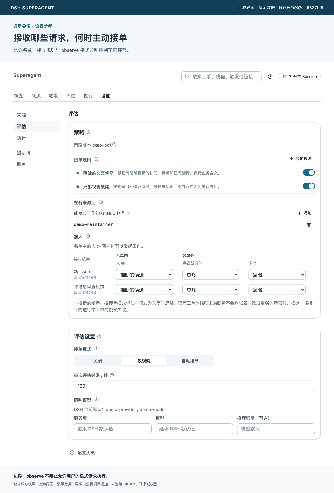
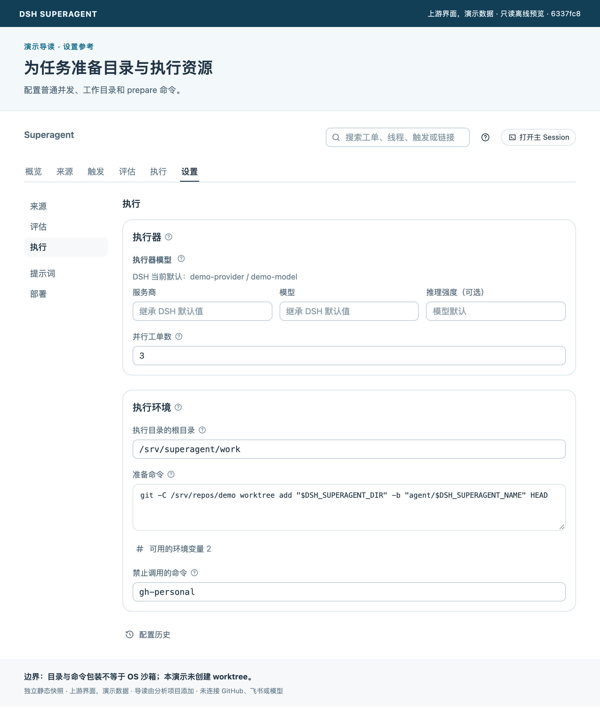

# 05 使用与上手：从阅读到首次工单

[返回首页](../README.md) · [上一章](04-design-lessons.md) · [下一章：迁移指南](06-adaptation-guide.md)

## 先选择你要尝试的东西

| 目标 | 路径 | 是否需要模型或平台凭据 |
| --- | --- | --- |
| 了解机制和界面 | 阅读本文并打开[离线预览](../tools/preview/README.md) | 不需要 |
| 把原型运行在自己的仓库上 | 本章的 GitHub-only 路径 | 需要 DSH 模型配置与专用 GitHub 账号 |
| 接入新平台或复用核心设计 | [迁移指南](06-adaptation-guide.md) | 取决于目标系统 |

以下部署路径根据固定版本[上游安装说明][install]整理，本文档制作没有配置真实机器人或执行外部端到端任务。具体已完成验证见[验证记录](reference/verification.md)。

## 最短部署路径：先只接 GitHub

### 1 准备运行环境与账户

上游要求 Node.js `^22.19.0 || >=24.0.0`、pnpm、Git 2.32+、Python 3.8+、tmux，以及 GitHub CLI 2.48+。Bundle 要求的 DSH 范围为 `^0.2.1-alpha.2`，上游部署文档给出的公开安装版本是 `0.2.1-rc.3`。同时在 DSH 配置可用的模型提供者。[安装依据][install]

准备一个在目标 github.com 仓库中有必要权限的 Agent 账号。使用专门的 GitHub CLI 配置目录区分它与个人账号，核实实际登录身份。当前部署文档不支持 GitHub Enterprise Server。

Worker 预设以运行服务的 OS 用户权限执行工具。应选择与个人日常环境分离的 OS 账户或机器，并只放入需要的凭据；`blockedCommands` 和包装脚本不构成强隔离。[权限说明][deployment]

### 2 固定源码并构建

```sh
npm install -g @deepseek-ai/dsh@0.2.1-rc.3
git clone https://github.com/deepseek-ai/dsh-superagent-prototype.git
cd dsh-superagent-prototype
git checkout 6337fc823ce20251c8de8085948165c81aaa701e
pnpm install --frozen-lockfile
pnpm build
```

这些命令安装和构建原项目；本分析仓库自身不需要运行 DSH。想检查上游开发状态可运行 `pnpm check`，它包含类型检查、测试和构建。

### 3 为它新建专用 DSH profile

**仅限尚无 `superagent` profile 的全新安装：**

```sh
dsh superagent --from-default-profile web --dump-config > /dev/null
dsh plugin --profile superagent add "link:$PWD"
```

上游明确提醒：对已有 profile 重复执行创建命令会替换 profile 并删除原 `cordis.patch.yml`。已有部署应遵循上游升级步骤，先备份，不重建 profile。[新建与升级区别][install]

依据上游[配置示例][prepare]设置 `webserver` 和 `dsh-superagent.stateDir`，使用自己的绝对路径。`stateDir` 保存数据库、锁、命令包装和默认工作目录；它不是本分析仓库的目录。飞书先保持关闭。

### 4 启动，再在面板补齐设置

```sh
scripts/dsh-superagent start
scripts/dsh-superagent status
```

打开日志打印的地址，在 DSH 侧栏选择 **Superagent**。示例端口为 3082，实际以配置和日志为准。在设置中依次完成：

| 设置区 | 最小配置 | 检查点 |
| --- | --- | --- |
| Sources | GitHub 仓库 `owner/name`、Agent 账号的 gh 包装命令 | 显示的账号和仓库与预期一致 |
| Eval | 允许用户名单，保留 observe | 先只允许自己的账号；理解显式请求仍可能执行 |
| Execution | 工作目录、prepare 命令与并发 | 验证每个工单能得到正确 checkout，而非空目录 |
| Prompts | 作者身份、团队沟通与交付要求 | 首次尝试保留人工合并流程 |

prepare 可使用 `DSH_SUPERAGENT_DIR`、`DSH_SUPERAGENT_NAME`、`DSH_SUPERAGENT_GITHUB_REPOSITORY` 和 PR head 等变量。命令需要结合本地 clone 的路径与 refs 决定，不能直接复制别人的机器路径。可以先在独立临时目录人工验证准备逻辑。

### 5 从一个小请求开始验收

从允许名单中的账号，在目标仓库的 Issue 中请求一个目标明确、可验证的小修复：`@你的Agent账号 请修正这里的拼写错误，保持原意`。

在默认约一分钟的轮询窗口内，观察是否出现 Trigger、Decision 与 Ticket；随后检查 Worker Session、实际工作目录、原讨论的确认与最终结果。它是异步路径，不能仅以 HTTP 服务正常启动判断 Agent 工作链路可用。

成功标准应包括：身份正确、授权范围正确、目录正确、修改有验证证据、回复到正确讨论。如果产生 PR，继续检查反馈是否回到原工单；PR 已创建不等于工单已验收。

## 设置界面参考

以下两张图使用真实上游组件与虚构配置，只展示设置位置，未连接真实平台或模型，也未创建 worktree。目录和命令应按自己的部署环境配置。

<details>
<summary><strong>评估策略：允许名单、接收规则与 observe 模式</strong></summary>

[](../assets/screenshots/policy.png)

`observe` 限制推断候选接单；允许用户的显式请求仍可能执行。

</details>

<details>
<summary><strong>执行配置：普通并发、工作目录与 prepare</strong></summary>

[](../assets/screenshots/execution.png)

独立目录、prepare 和命令包装各有作用，不能当作 OS 沙箱。

</details>

## 可选：接入飞书

完成 GitHub 路径后，再按上游部署文档创建和发布 bot、配置 `lark-cli`，启用飞书 Source，选择接收群和允许用户范围。凭据只在本机或部署平台配置，不放进 Issue、聊天记录或截图。无需为了理解架构而先安装飞书。[原始部署指南][install]

## 常见问题从哪查

| 现象 | 优先检查 |
| --- | --- |
| 没看到 Trigger | Source 是否启动、账号身份、仓库或群范围、轮询状态 |
| 事件被过滤或没有接单 | 来源过滤原因、允许名单、是否明确发给 Agent、接单模式和匹配规则 |
| 工单出现但目录为空 | prepare 是否配置、是否成功、工作目录是否已存在 |
| 任务待人工处理 | 工单的具体 action、Attention、失败或投递错误，不只看 summary |
| 收不到回复 | Outbox 回执、来源是否关闭、目标讨论是否还可接收 |
| 重启后无法继续 | profile 的角色预设是否保留、DSH 版本、数据库与会话恢复状态 |

`status` 的退出码：0 表示正常运行；1 表示未运行、重复实例、无响应或 runtime 错误；2 表示某个组件异常；3 表示等待设置。重启不能自动解决缺账号或策略配置的问题。[部署状态说明][install]

## 停止、备份与升级

用 `scripts/dsh-superagent stop` 有意停止服务。升级前等待执行器退出活跃回合，并备份状态目录中的 `orchestrator.sqlite`。新版迁移后的数据库可能不能由旧版读取，回退要使用升级前备份。停止服务不等于清理它已在 GitHub 创建的分支、评论或 PR，这些应按实际产物核对处理。

[deployment]: https://github.com/deepseek-ai/dsh-superagent-prototype/blob/6337fc823ce20251c8de8085948165c81aaa701e/docs/006-deployment.md#L13
[install]: https://github.com/deepseek-ai/dsh-superagent-prototype/blob/6337fc823ce20251c8de8085948165c81aaa701e/docs/006-deployment.md#L71
[prepare]: https://github.com/deepseek-ai/dsh-superagent-prototype/blob/6337fc823ce20251c8de8085948165c81aaa701e/examples/profile.cordis.patch.yml#L1
